<div align="center">

# Lighthouse 8-Puzzle

**An 8-bit search lab on the shore of Alexandria.**
The great lighthouse has crumbled into nine tiles. Slide them back together yourself, or watch BFS, DFS, IDDFS and A\* do it for you, and when the tower stands whole, its lamp lights up the night.


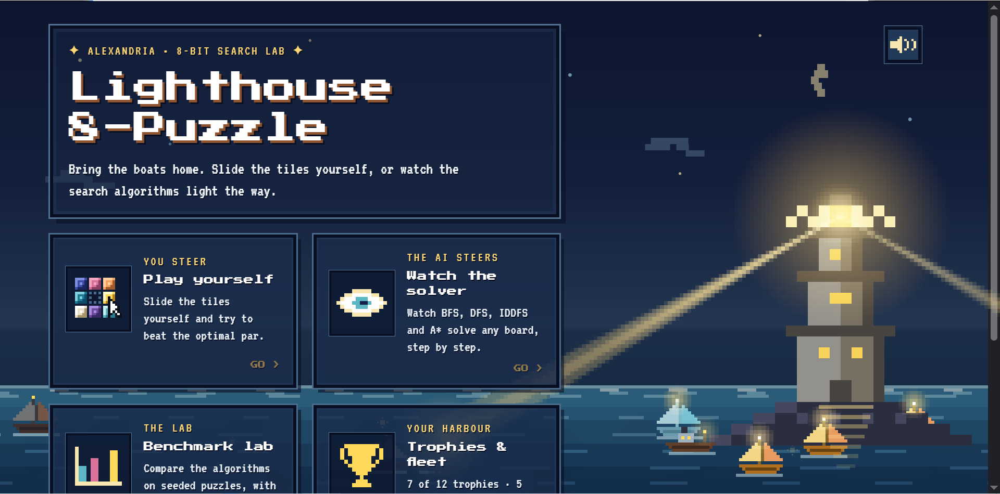

</div>

---

## Contents

**The tour**
[Main menu](#the-main-menu) · [Watch the solver](#watch-the-solver) · [Play yourself](#play-yourself) · [Benchmark lab](#benchmark-lab) · [Trophies and fleet](#trophies-and-fleet)

**Under the hood**
[Quick start](#quick-start) · [Project structure](#project-structure) · [Architecture](#architecture) · [The solver](#the-solver) · [HTTP API](#http-api) · [The frontend](#the-frontend) · [Benchmark methodology](#benchmark-methodology) · [Command-line runner](#command-line-runner) · [Testing the server](#testing-the-server) · [Known issues](#known-issues) · [Authors](#authors)

---

# Part 1 · The tour

Everything you see below is drawn in code: the lighthouse, the boats, the sea, the tiles and the sound effects. Apart from web fonts, the frontend has no image or audio files, only a canvas, some CSS and the Web Audio API.

## The main menu

A single full-screen canvas: the tower sweeps its beam across the water, and the boats you have earned sit in the harbour while visitors sail in from the dark, get picked out by the light, dock, and leave again.

<table>
<tr>
<td width="50%"></td>
<td width="50%">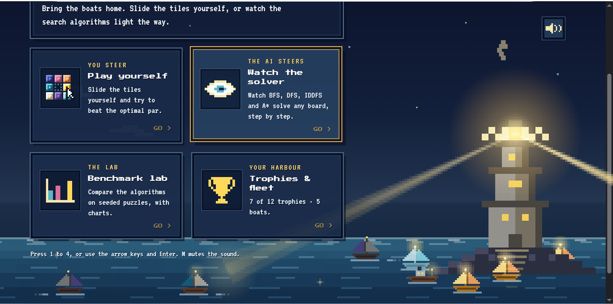</td>
</tr>
<tr>
<td align="center"><sub>The title screen</sub></td>
<td align="center"><sub>Four modes. Press <kbd>1</kbd>–<kbd>4</kbd>, or use the arrow keys and <kbd>Enter</kbd></sub></td>
</tr>
</table>

## Watch the solver

Type any board (or hit **Shuffle**), pick an algorithm, and press **Solve**. The server runs the search and the page replays the solution one slide at a time, with a scrubber, step buttons and adjustable speed. The Result panel reports the cost, nodes expanded, nodes generated, goal depth and search time.

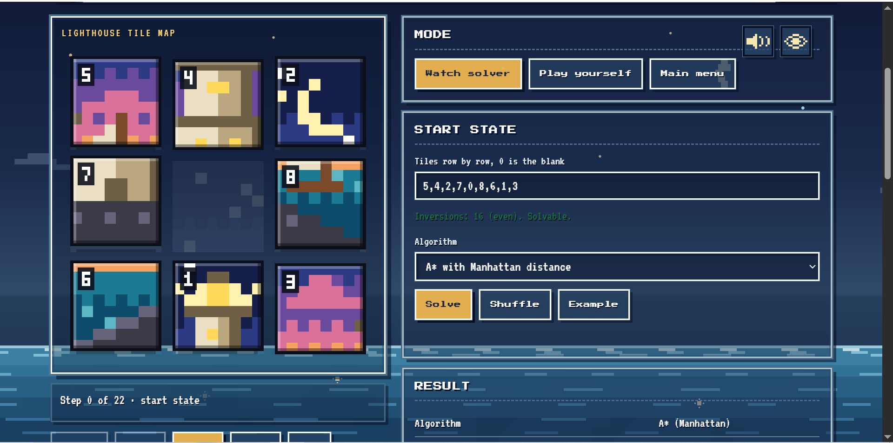

The nine tiles are one 24 × 24 pixel painting of the Lighthouse of Alexandria, cut into a 3 × 3 grid. Solve the puzzle and the picture reassembles. After a moment it lifts off the board and sinks into the night sky, becoming the beacon behind the interface.

<table>
<tr>
<td width="50%">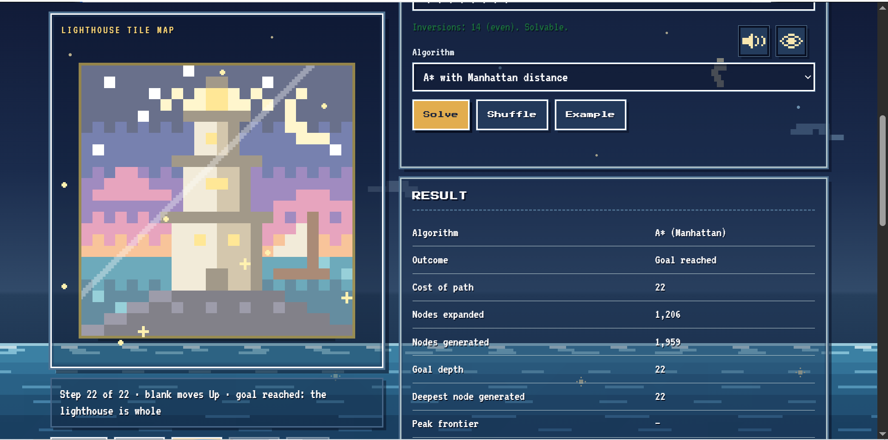</td>
<td width="50%">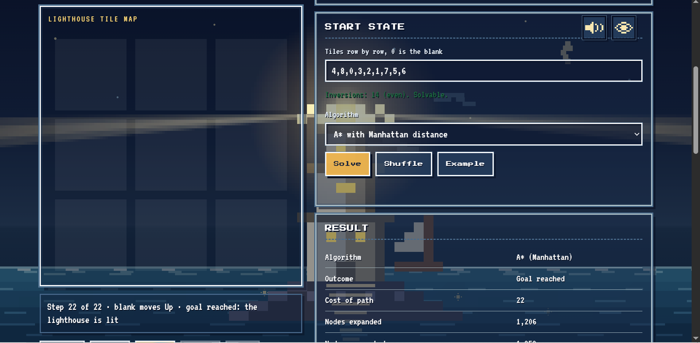</td>
</tr>
<tr>
<td align="center"><sub>Step 22 of 22: the tiles fuse into one picture</sub></td>
<td align="center"><sub>Then the picture takes to the sky and the lamp lights</sub></td>
</tr>
</table>

Press <kbd>H</kbd> (or the eye button in the dock) to hide the interface and just watch the light.

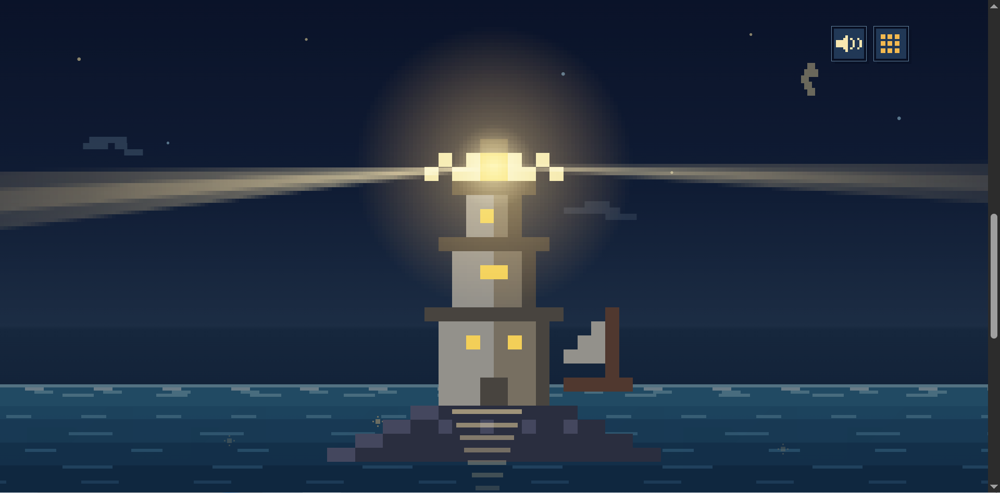

## Play yourself

Slide the tiles with the mouse, or with the arrow keys (the tile slides the way you press). Every scramble is generated by walking backwards from the goal, so every board is solvable. **Par** is the optimal move count, fetched from the solver. Stuck? **Hint** asks the solver for the best next move and makes that tile glow, at the price of a hint on your record.

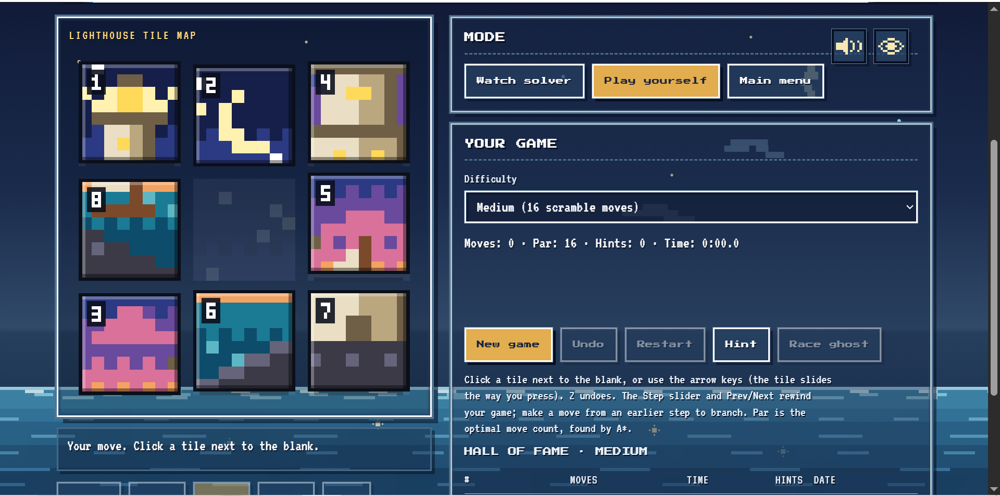

- **Difficulty:** Easy (6 scramble moves), Medium (16), Hard (30), any solvable board, or a **custom board** you build by swapping tiles.
- **Undo, restart, rewind:** <kbd>Z</kbd> undoes. The step slider rewinds your game, and moving from an earlier step branches it.
- **Race the ghost:** after a win, replay your solution side by side with the optimal one on the same start board.
- **Hall of fame:** the top five per difficulty (or per custom board), ranked by moves over par, then hints, then time.

## Benchmark lab

Run a seeded set of puzzles through any combination of the five algorithms and compare them. The same seed always produces the same puzzles, so results can be reproduced and shared.

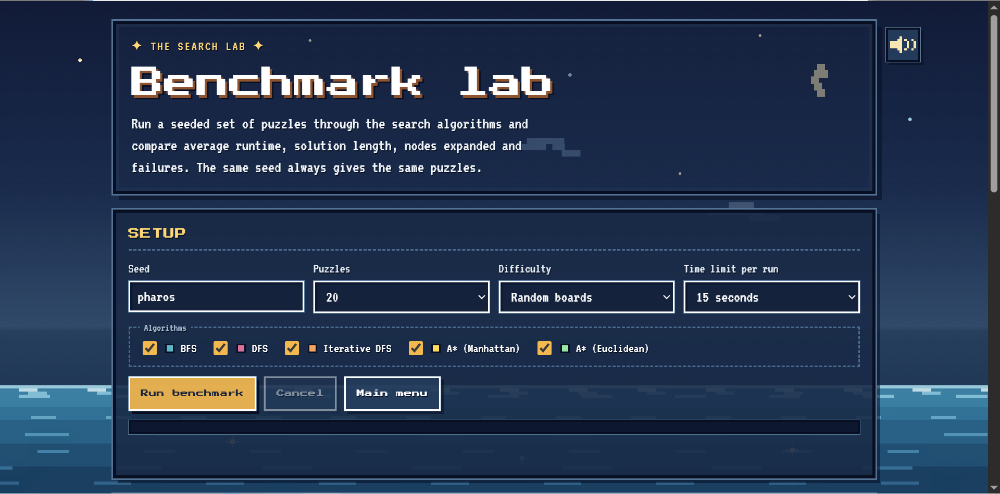

A results table highlights the best value in each column in green, and the charts underneath use a log scale so that A\* and IDDFS can share an axis.

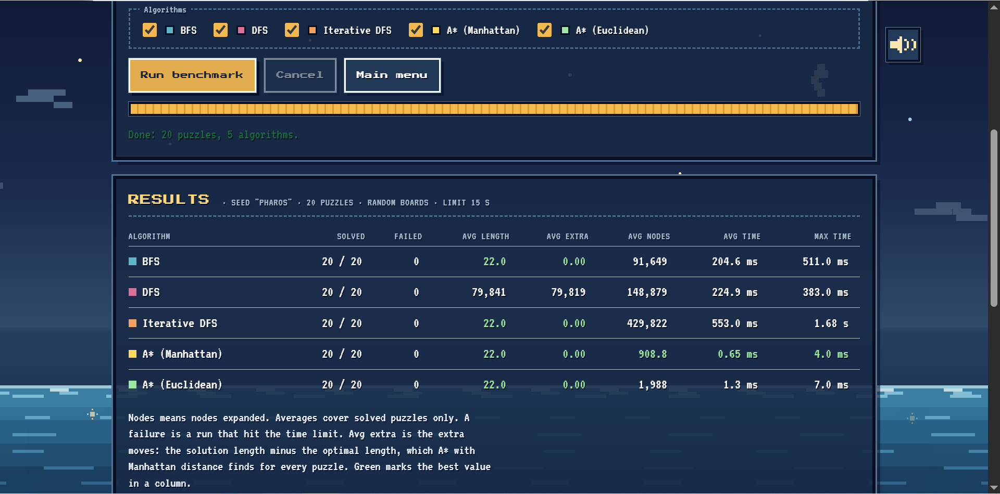

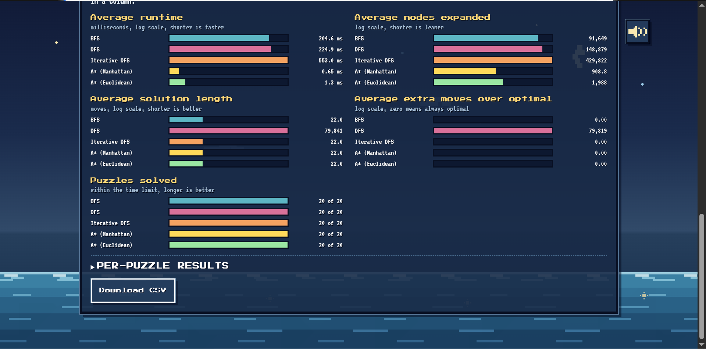

A sample run (seed `pharos`, 20 random boards, 15 s limit per run):

| Algorithm | Solved | Avg length | Avg extra moves | Avg nodes expanded | Avg time | Max time |
|---|---:|---:|---:|---:|---:|---:|
| BFS | 20 / 20 | 22.0 | 0.00 | 91,649 | 204.6 ms | 511.0 ms |
| DFS | 20 / 20 | 79,841 | 79,819 | 148,879 | 224.9 ms | 383.0 ms |
| Iterative DFS | 20 / 20 | 22.0 | 0.00 | 429,822 | 553.0 ms | 1.68 s |
| **A\* (Manhattan)** | 20 / 20 | 22.0 | 0.00 | **908.8** | **0.65 ms** | **4.0 ms** |
| A\* (Euclidean) | 20 / 20 | 22.0 | 0.00 | 1,988 | 1.3 ms | 7.0 ms |

Three things worth noticing: BFS, IDDFS and both A\* variants are always optimal (extra moves 0.00); DFS finds a solution but wanders (an average of roughly 80,000 moves); and A\* with Manhattan distance expands about a hundred times fewer nodes than BFS. See [the solver](#the-solver) for why.

Every run can be exported with **Download CSV**, one row per puzzle and algorithm.

## Trophies and fleet

Twelve trophies reward good play and curiosity, and every win docks a boat in your harbour. Your fleet sails into the main-menu scene and stays there.

<table>
<tr>
<td width="50%">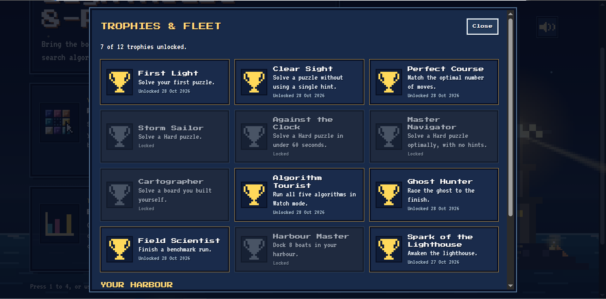</td>
<td width="50%">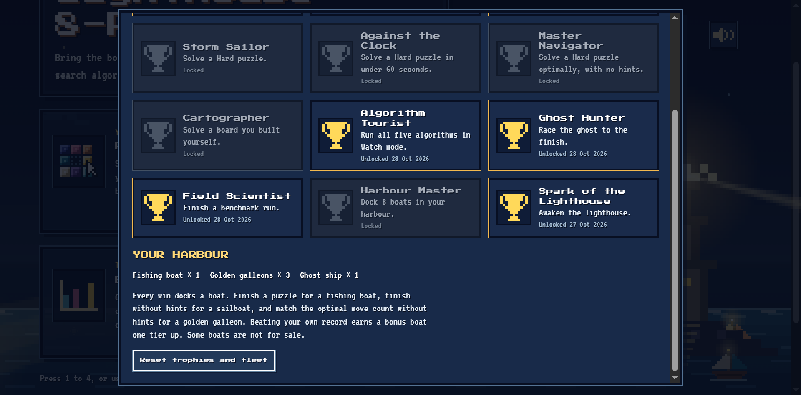</td>
</tr>
<tr>
<td align="center"><sub>Trophies, with unlock dates</sub></td>
<td align="center"><sub>The fleet, and how boats are earned</sub></td>
</tr>
</table>

| Boat | How to earn it |
|---|---|
| Fishing boat | Finish a puzzle |
| Sailboat | Finish without hints |
| Golden galleon | Match the optimal move count without hints |
| Bonus boat, one tier up | Beat your own record |
| Ghost ship | Not for sale. The lamp looks ticklish... |

---

# Part 2 · Under the hood

## Quick start

**Requirements:** JDK 24 (set in `backend/pom.xml`; the code itself only uses language features available since Java 21), Maven 3.9+, and any modern browser.

**1. Start the solver server** (listens on `http://localhost:8080`):

```bash
cd backend
mvn compile exec:java -Dexec.mainClass=io.github.ThisIsNotMyAI.server.Server
```

In IntelliJ, open `backend/` as a Maven project and run `Server.main`.

**2. Open the frontend.** It is plain HTML, CSS and JavaScript with no build step. Either open `frontend/index.html` directly, or serve the folder:

```bash
cd frontend
python3 -m http.server 5173     # then visit http://localhost:5173
```

The page solves a default board as soon as it loads. If the server is not running, Watch mode, par, hints, the ghost race and the benchmark show a "could not reach the solver" message rather than failing silently.

The server address is the `SERVER_URL` constant at the top of `frontend/Api.js`.

## Project structure

```text
.
├── backend/                                   Java 24 · Maven
│   ├── pom.xml                                Jackson 2.22 (core, annotations, databind)
│   └── src/main/java/io/github/ThisIsNotMyAI/
│       ├── Main.java                          Command-line runner (all five algorithms)
│       ├── solver/
│       │   ├── State.java                     Board as a packed long (4 bits per cell)
│       │   ├── Action.java                    UP / DOWN / LEFT / RIGHT and how to apply them
│       │   ├── Node.java                      Search node: state, parent, action, g, h
│       │   ├── Heuristic.java                 Manhattan and Euclidean distance
│       │   ├── Solver.java                    BFS, DFS, IDDFS and A*
│       │   └── SearchResult.java              Outcome and statistics of one search
│       └── server/
│           ├── Server.java                    HTTP server: POST /solve
│           ├── HeaderName.java                Header name constants
│           ├── HeaderValue.java               Header value constants (CORS, JSON)
│           ├── server-test.http               Request collection for the IntelliJ HTTP client
│           └── json/
│               ├── Algorithm.java             BFS, DFS, IDDFS, ASTAR_MANHATTAN, ASTAR_EUCLIDEAN
│               ├── SolveRequest.java          Request record and its validation
│               ├── SolveResult.java           One algorithm's result
│               └── SolveResponse.java         { "results": { <algorithm>: <result> } }
└── frontend/                                  Vanilla JS · no dependencies
    ├── index.html                             Menu, watch, play, benchmark and modal markup
    ├── styles.css                             Pixel-art theme, animated sea and clouds (~790 lines)
    ├── Puzzle.js                              Board helpers: swap, inversions, parsing, neighbours
    ├── Api.js                                 Client for POST /solve, error handling, optimal-move cache
    └── script.js                              Everything else (~2,650 lines, one IIFE)
```

## Architecture

The browser never searches. Every search in the page (watch, play-mode par and hints, ghost race and benchmark) is a `POST /solve` to the Java server, which owns the algorithms.

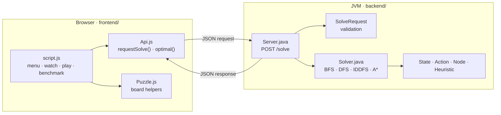

The search returns only a **move string** (for example `ULL`) plus statistics. The frontend rebuilds every intermediate board by replaying the moves from the start state, which is why the same player drives watch mode, your own games, the trace JSON loader and the ghost race.

## The solver

### State representation

A board is a permutation of the digits 0–8 written row by row, with 0 as the blank. `State` packs it into a single `long`, four bits per cell:

$$\texttt{mask} = \sum_{i=0}^{8} c_i \cdot 16^{\,i}$$

where $c_i$ is the tile in cell $i$ (cells numbered row-major from the top-left). `State` is a Java `record State(long mask)`, so `equals` and `hashCode` come for free and states can sit directly in a `HashSet` or `HashMap`. Reading a cell is a shift and a mask, and swapping two cells is three bit operations, so generating a successor allocates nothing but one small object.

The **goal** is `012345678`, i.e. `mask = 0x876543210`, with the blank in the top-left corner. The legal moves for each blank position are precomputed once in a static table (`LEGAL_ACTIONS[9]`), so `getLegalActions()` is a scan for the blank plus an array lookup.

A move is named by the direction the **blank** travels, and encoded as one character: `U`, `D`, `L`, `R`. A solution is therefore a string over `{U, D, L, R}`.

### Solvability

Of the $9! = 362{,}880$ arrangements, exactly half are reachable from the goal: $9!/2 = 181{,}440$. Because the board width (3) is odd, a horizontal move never changes the inversion count and a vertical move changes it by an even amount, so the **parity of the inversion count is invariant**. A board is solvable if and only if its number of inversions (ignoring the blank) is even. This is checked in three places: the CLI (`Main.isSolvable`), the request validator (`SolveRequest`), and the frontend (`Puzzle.js → inversions`), where the Start State panel shows the count live ("Inversions: 16 (even). Solvable.").

### Algorithms

All four searches share one `Node` record, `(state, parent, action, g, h)`, and rebuild the answer by following `parent` pointers from the goal back to the root.

| | Frontier | Complete | Optimal | Notes |
|---|---|:---:|:---:|---|
| **BFS** | FIFO queue (`ArrayDeque`) | yes | yes (unit step cost) | Expands every state at depth $d$ before any at depth $d+1$. |
| **DFS** | LIFO stack (`Collections.asLifoQueue`) | yes (graph search on a finite space) | no | Follows one branch as deep as it goes, so the first solution found can be very long. |
| **IDDFS** | explicit stack, depth limit $0, 1, 2, \dots$ | yes | yes | DFS memory profile with BFS optimality, paid for by repeated work. |
| **A\*** | `PriorityQueue` ordered by $f(n)=g(n)+h(n)$ | yes | yes, since $h$ is admissible and consistent | Two heuristics: Manhattan and Euclidean. |

BFS, DFS and A\* are the same function (`Solver.search`) parameterised by the frontier. This is the graph-search schema:

1. Put the root in the frontier.
2. Remove a node. **Goal test happens here**, when a node leaves the frontier, not when it is generated.
3. If its state has not been explored, mark it explored (this is an *expansion*), and add each successor whose state is not yet explored.
4. Repeat until the goal is found or the frontier is empty.

For BFS the goal test at removal costs one extra level of generation compared with testing at generation, but it keeps the three algorithms identical and is what makes A\* correct. IDDFS runs its own depth-limited pass (`depthLimited`) with a `bestDepth` map: a state is skipped if it was already reached at the same or a smaller depth in the current pass. A pass that ends with no node cut off by the limit proves there is no solution, and the loop stops.

### Heuristics

Let $(r_i, c_i)$ be the current row and column of tile $i$, and $(r_i^*, c_i^*) = (\lfloor i/3 \rfloor,\ i \bmod 3)$ its goal position. The blank is not counted.

$$h_{\text{Manhattan}}(s)=\sum_{i=1}^{8}\bigl(|r_i-r_i^*|+|c_i-c_i^*|\bigr) \qquad h_{\text{Euclidean}}(s)=\sum_{i=1}^{8}\sqrt{(r_i-r_i^*)^2+(c_i-c_i^*)^2}$$

**Admissibility.** A move slides exactly one tile by exactly one cell, so every move can reduce $h_{\text{Manhattan}}$ by at most 1. Reaching the goal (where $h=0$) from $s$ therefore needs at least $h_{\text{Manhattan}}(s)$ moves, so $h_{\text{Manhattan}}(s) \le h^*(s)$. The same move changes each tile's Euclidean distance by at most 1 as well, and for every tile $\sqrt{\Delta r^2+\Delta c^2} \le |\Delta r|+|\Delta c|$, hence

$$h_{\text{Euclidean}}(s)\ \le\ h_{\text{Manhattan}}(s)\ \le\ h^*(s).$$

**Consistency.** For a move from $s$ to $s'$ with step cost 1, $|h(s)-h(s')| \le 1$ for both heuristics (one tile moves by one cell), so $h(s)\le 1+h(s')$. With a consistent heuristic, the first time A\* removes a state from the frontier it has reached it by a cheapest path, so the explored set never has to be reopened and the solution is optimal.

**Why Manhattan wins.** Both heuristics are admissible, but $h_{\text{Euclidean}} \le h_{\text{Manhattan}}$ means Manhattan *dominates*: it is closer to the true cost, so (up to tie-breaking) A\* expands no more states with it than with the weaker heuristic. That is exactly what the benchmark shows (about 909 versus 1,988 nodes on average).

### Statistics reported

| Field | Meaning |
|---|---|
| `expanded` | Nodes removed from the frontier and expanded. The goal node itself is **not** counted, because the goal test fires before expansion. |
| `generated` | Nodes created, including the root. |
| `maxDepth` | Depth of the deepest node generated. |
| `cost` / `goalDepth` | Length of the returned solution in moves. |
| `ms` | Search time only, measured with `System.nanoTime()`. Drawing is not included. |

IDDFS adds the counters of all its passes together. The average optimal solution length over all 181,440 solvable boards is about 22 moves and no board needs more than 31, which is why the benchmark averages sit at 22.0 for the optimal algorithms.

## HTTP API

One endpoint, implemented with the JDK's built-in `com.sun.net.httpserver` (no web framework) and Jackson for JSON.

### `POST /solve`

**Request**

```json
{
  "initialConfiguration": "125340678",
  "algorithms": ["BFS", "ASTAR_MANHATTAN"]
}
```

| Field | Type | Rules |
|---|---|---|
| `initialConfiguration` | string | Exactly 9 characters, a permutation of `0`–`8` (row-major, `0` is the blank), with an **even** inversion count. |
| `algorithms` | array | Non-empty. Any of `BFS`, `DFS`, `IDDFS`, `ASTAR_MANHATTAN`, `ASTAR_EUCLIDEAN`. |

Unknown JSON fields are rejected (Jackson's default). The compact constructor of the `SolveRequest` record does the validation, so an invalid request never reaches the solver.

**Response `200 OK`**

```json
{
  "results": {
    "BFS": {
      "algorithm": "BFS",
      "moves": "ULL",
      "solved": true,
      "cost": 3,
      "expanded": 10,
      "generated": 22,
      "goalDepth": 3,
      "maxDepth": 4,
      "ms": 22.0
    },
    "ASTAR_MANHATTAN": { "algorithm": "ASTAR_MANHATTAN", "moves": "ULL", "solved": true, "cost": 3,
                         "expanded": 3, "generated": 7, "goalDepth": 3, "maxDepth": 3, "ms": 0.0 }
  }
}
```

`moves` is the sequence of blank moves (`U`, `D`, `L`, `R`) and is omitted (`null` fields are not serialised) when no solution is found.

Failures come back as `{ "Error": "<message>" }`. Status codes:

| Status | When |
|---|---|
| `400 Bad Request` | Malformed JSON, unknown field or algorithm name, bad board, unsolvable board, empty algorithm list |
| `405 Method Not Allowed` | Any method other than `POST` and `OPTIONS` |
| `204 No Content` | `OPTIONS` (CORS pre-flight) |

CORS is open (`Access-Control-Allow-Origin: *`, methods `POST, OPTIONS`, header `Content-Type`), which is what lets the page be opened from a file or from any local static server.

```bash
curl -s -X POST http://localhost:8080/solve \
     -H 'Content-Type: application/json' \
     -d '{"initialConfiguration":"125340678","algorithms":["ASTAR_MANHATTAN"]}'
```

## The frontend

No framework, no bundler, no dependencies beyond the Google Fonts stylesheet (Press Start 2P, VT323, Pixelify Sans and IBM Plex).

| File | Responsibility |
|---|---|
| `Puzzle.js` | Pure helpers: `GOAL`, neighbour table `NEI`, `swap`, `inversions`, `parseState`, and the `U/D/L/R` ↔ `Up/Down/Left/Right` maps. |
| `Api.js` | `requestSolve(state, algorithmKeys, {timeoutMs, signal})` does one POST for any number of algorithms and turns failures into typed errors (`timeout`, `network`, `cancel`, `http`, `format`). `optimal(state)` asks for the A\* (Manhattan) solution and caches it (up to 300 boards), so par, hints and the ghost race never ask twice. |
| `script.js` | The rest, in this order: pixel sprite, synthesised sound, the beacon, board drawing and tile animation, the playback player, trace JSON, focus mode, play mode and hall of fame, trophies and fleet, the menu scene, the ghost race, the benchmark lab, and screen switching. |
| `styles.css` | The pixel-art theme, and the animated sea and clouds. Honours `prefers-reduced-motion`. |

**Design notes**

- **One player for everything.** A game is a growing trace of `states[]` and `moves[]`. Watching a solver, playing yourself, rewinding, undoing and branching all reuse the same slide animation, the same merge into the lighthouse and the same scrubber.
- **Art and sound are generated.** The lighthouse is a 24 × 24 pixel sprite defined in code. Tile `v` shows the 8 × 8 block at column `v mod 3`, row `⌊v/3⌋` of that sprite, which is why the finished board has the blank in the top-left corner. The light is rendered at one fifth resolution and scaled up so even the glow is pixel art. All music and effects are synthesised with the Web Audio API.
- **Accessible by default.** Live regions announce results and errors, controls have labels, everything is reachable from the keyboard, and the `prefers-reduced-motion` setting is respected.
- **Persistence is `localStorage` only**, always wrapped in `try/catch` so a blocked store degrades quietly.

| Key | Used for |
|---|---|
| `pharos-scores-v1` | Hall of fame |
| `pharos-ach-v1` | Unlocked trophies |
| `pharos-fleet-v1` | Boats in the harbour |
| `pharos-stats-v1` | Algorithms tried in Watch mode |
| `pharos-bench-v1` | Last benchmark run |
| `lighthouse-muted` | Sound on or off |

**Keyboard**

| Where | Keys |
|---|---|
| Main menu | <kbd>1</kbd>–<kbd>4</kbd> pick a card · arrows + <kbd>Enter</kbd> · <kbd>M</kbd> mute |
| Watch mode | <kbd>Space</kbd> play and pause · <kbd>←</kbd> <kbd>→</kbd> step · <kbd>Home</kbd> <kbd>End</kbd> jump · <kbd>H</kbd> hide the interface · <kbd>Esc</kbd> back |
| Play mode | Arrow keys slide a tile · <kbd>Z</kbd> or <kbd>Backspace</kbd> undo |
| Anywhere | <kbd>M</kbd> mute · <kbd>Esc</kbd> closes dialogs and goes back |

### Trace JSON

The **Trace JSON** panel in Watch mode replays any solution from a start state and a move string:

```json
{"algorithm":"A* Manhattan","initial":"125340678","moves":"UL","expanded":3,"generated":7,"maxDepth":3,"ms":0.4}
```

Every board is rebuilt from `initial` and `moves`, so a solution is a few bytes and can be pasted into a report.

## Benchmark methodology

- **Reproducible boards.** The seed string is hashed with xmur3 and fed to a mulberry32 PRNG, so the same seed, count and difficulty always yield the same boards. Duplicates and the already-solved board are skipped.
- **Two board generators.** *Scramble* difficulties (Easy 8, Medium 16, Hard 24 moves) walk backwards from the goal without immediately undoing the previous move. *Random boards* are uniform random permutations, with one swap of two non-blank tiles when the parity is odd, so every board is solvable.
- **Reference optimum.** For each puzzle, A\* with Manhattan distance runs first (60 s allowance) and provides the optimal length, from which **Avg extra** (solution length minus optimal) is computed.
- **Time limit.** Each algorithm gets a limit of 2, 5 or 15 s per puzzle. A run that exceeds it is a **failure**, and averages cover **solved puzzles only**. The limit is enforced in the browser by aborting the request.
- **Cancel** aborts the request in flight and keeps the partial results. The last run is stored in `localStorage` and re-displayed on the next visit.
- **CSV export** columns: `seed, difficulty, puzzle, start, optimal, algorithm, status, length, nodes_expanded, nodes_generated, ms`.

## Command-line runner

`Main` runs all five algorithms on one board and prints the path, the statistics and every intermediate board as a box drawing. It is the quickest way to check a solver change without the browser.

```bash
cd backend
mvn compile exec:java -Dexec.mainClass=io.github.ThisIsNotMyAI.Main -Dexec.args="125340678"
```

The board can be given as `125340678` or as `1,2,5,3,4,0,6,7,8`. With no argument the program asks for one, and it re-prompts on invalid input. An unsolvable board is reported (odd inversion count) and no search is run. Printing stops after 1,000 steps, which matters for DFS.

```text
=============================================
A* (Manhattan)
=============================================
Algorithm:        A*
Path to goal:     ULL
Path cost:        3
Search maxDepth:     3
Nodes expanded:   3
Nodes generated:   7
Running time:     0.106 ms

Step 0 (start)
┌───┬───┬───┐
│ 1 │ 2 │ 5 │
├───┼───┼───┤
│ 3 │ 4 │   │
├───┼───┼───┤
│ 6 │ 7 │ 8 │
└───┴───┴───┘
Step 1: move blank UP
┌───┬───┬───┐
│ 1 │ 2 │   │
├───┼───┼───┤
│ 3 │ 4 │ 5 │
...
Goal reached!
```

## Testing the server

`backend/src/main/java/io/github/ThisIsNotMyAI/server/server-test.http` is a request collection for the IntelliJ HTTP Client (it also works as a reference for `curl`). It covers the happy path, all five algorithms, the CORS pre-flight, a wrong method, an unknown algorithm, malformed JSON, an unknown field, an unsolvable board and an invalid board.

## Known issues

Honest notes for anyone picking this up:

- **Timing resolution.** `Server.mapSearch` converts nanoseconds with integer division (`elapsedNanos()/1000000`), so the API's `ms` is a whole number of milliseconds and sub-millisecond A\* runs report `0.0`. This is why the benchmark averages for A\* look like `0.65 ms`: they are averages of whole-millisecond values. Dividing by `1_000_000.0` fixes it.
- **Peak frontier.** The UI has a "Peak frontier" row, but the server does not send `peakFrontier` yet, so it shows a dash.
- **Single-threaded server.** `HttpServer` runs with its default executor, so requests are handled one at a time. The benchmark's time limit only stops the page waiting, it does not cancel the search on the server, so a timed-out DFS or IDDFS run keeps the server busy until it finishes.
- **DFS paths are long by nature.** DFS is not optimal. On hard boards its solutions can be tens of thousands of moves long (see the sample benchmark).
- **Test file drift.** In `server-test.http`, cases 8 and 9 still use the old field name `initial` (they currently fail on the unknown field rather than on board validation), and some comments still say the server echoes the request.
- **Housekeeping.** `SearchResult` contains an unused private `toSolveResult` helper, there are no automated unit tests yet, and the solver URL is a constant in `Api.js`.

## Authors

Built by [Youssef Ali](https://github.com/YoussefRashidy) and [@nourr-ahmed](https://github.com/nourr-ahmed) as an Artificial Intelligence course project on uninformed and informed search.
